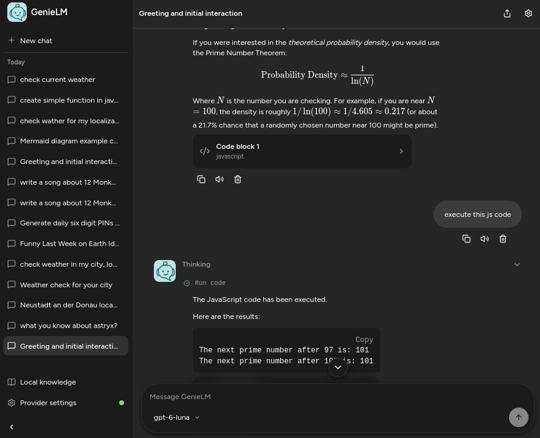

# GenieLM

<!---->


[](https://astryx.atmeta.com/)

[](https://github.com/sqliteai/sqlite-vector)
[](https://huggingface.co/Xenova/multilingual-e5-small)

<p align="center">
  
</p>

GenieLM is a React chat client for OpenAI-compatible models and ChatGPT OAuth. It uses TanStack Start and Astryx. The server streams responses, and the browser stores conversations.

Previous Svelte version: [GenieLM on GitHub](https://github.com/skorotkiewicz/GenieLM).

## Run locally

Install Bun and Node.js 22.13 or newer.

```sh
bun install
bun run sandbox:build # optional, needed for the code execution tool
bun run dev
```

Open [http://localhost:3000](http://localhost:3000). Select **Choose a model** and enter your OpenAI-compatible base URL, model name, and optional API key. Include the API prefix in the base URL. To use ChatGPT, select **ChatGPT** and follow the sign-in prompts for the community-maintained browser extension. The integration is unofficial.

Build and start the production server with:

```sh
bun run build
bun run start
```

The production server listens on the local loopback interface on port 3000 by default.

## Local knowledge

Download the multilingual E5 embedding model with the Hugging Face CLI before indexing documents:

```sh
hf download Xenova/multilingual-e5-small \
  config.json tokenizer.json tokenizer_config.json special_tokens_map.json \
  sentencepiece.bpe.model onnx/model_quantized.onnx \
  --local-dir multilingual-e5-small
```

GenieLM checks indexed documents and saved memories at the start of each turn. It can automatically save lasting preferences and project facts for future conversations. Select **Local knowledge** to manage documents and memories, or ask GenieLM to forget a memory. The server keeps the documents, memories, and embeddings in `knowledge.db`.

The optional code tool uses an isolated rootless Podman container. Run `bun run sandbox:build` to build its image.

## Moving from Svelte

GenieLM reads the existing conversation and provider settings when opened at the same browser origin as the Svelte app. Use the same scheme, hostname, and port to see the old history. API keys remain scoped to the browser tab. To carry over the local knowledge index, stop both apps and place the existing `knowledge.db` and `multilingual-e5-small/` in the React project directory.

## Checks

```sh
bun run typecheck
bun test src
bun run check
bun run build
bunx astryx doctor --built dist/client
```
